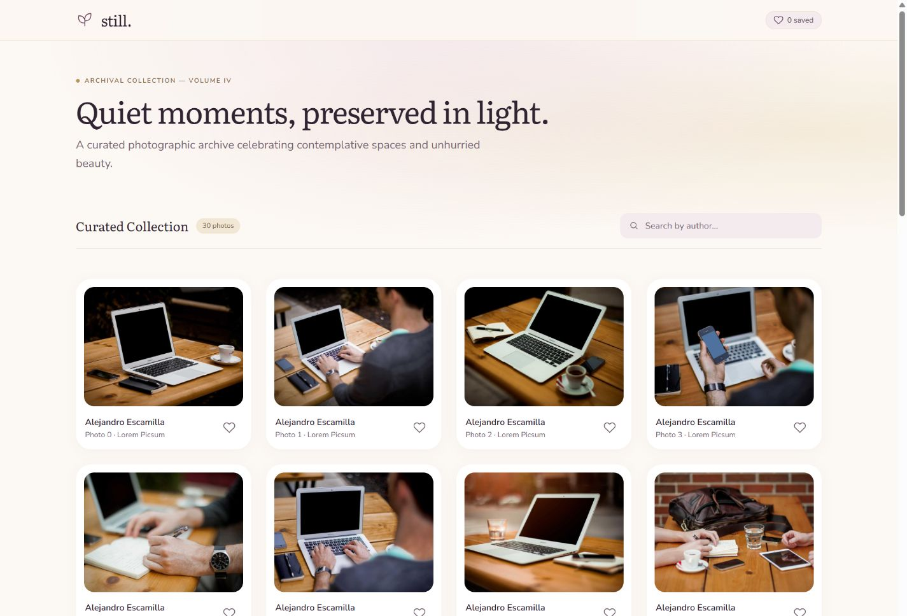
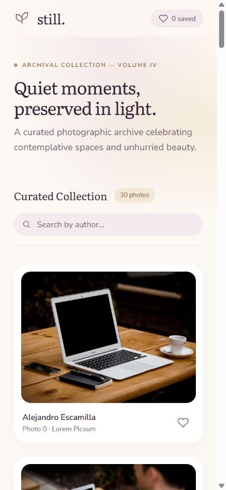

# Still — Photo Gallery

A focused React + Vite + Tailwind CSS submission for the Celebrare frontend internship assignment. Browse 30 photographs, search by author, and save favourites across refreshes. No component libraries or API keys.

## Screenshots

### Desktop



### Mobile



## Run locally

Requires Node.js 20.19+ or 22.12+ (Node 24 also works).

```sh
npm ci
npm run dev
```

Open the localhost URL printed by Vite.

```sh
npm test
npm run build
npm run preview
```

`build` writes the deployable static app to `dist/`. Both the photo API and image loading require internet access.

## Where the requirements live

| Requirement | Implementation |
| --- | --- |
| React, Vite, Tailwind only | `vite.config.js`, `src/styles.css` |
| Fetch 30 photos, spinner, error message | `src/hooks/useFetchPhotos.js` |
| 1 / 2 / 4 column responsive grid | `src/components/Gallery.jsx` (below 768px / 768px+ / 1024px+) |
| Real-time author search without requests | `handleSearch` and `filteredPhotos` in `Gallery.jsx` |
| Reducer favourites and localStorage | `src/state/favourites.js`, persistence effect in `Gallery.jsx` |
| Custom hook returns photos, loading, error | `useFetchPhotos` used by `Gallery` |
| useCallback and useMemo | Search handler and filtered list in `Gallery.jsx` |

## Design and decisions

- The supplied Stitch export guides the layout, Literata and Nunito Sans typography, and padded photo cards. The final premium palette pairs warm ivory (#fcf8f3), deep plum (#653b58), champagne gold (#d8b879), and soft blush (#f3ebee), inspired by the wedding invitation context. Fonts use Google Fonts with local fallbacks. Real Picsum authors and photos replace mockup content.
- The reducer stores photo IDs rather than duplicating fetched photo objects. One `toggle` action adds an absent ID or removes an existing one, without mutating the original array.
- The reducer's lazy initializer reads storage before the first render. An effect saves changes. Corrupt storage falls back to an empty list; unavailable storage produces a visible warning.
- Fetch checks HTTP status because `fetch` does not reject on HTTP 404/500. Cleanup aborts obsolete requests and prevents late state updates, including during React Strict Mode's development checks.
- Search trims whitespace and compares lowercase author names. The original input is preserved so typing remains natural.
- `useCallback` preserves the search handler's identity. This small app would still work without it; it is included as required. Its benefit here is limited because the input is not a memoized child.
- `useMemo` caches the filtered array until photos or query change. A favourite toggle can reuse it. Removing it would recalculate the filter on every render, but would not break correctness. Thirty photos do not need heavy optimization.
- Images use Picsum's ID-based, sized URLs rather than downloading the full original. Individual failed images have a readable fallback. Images below the initial row are lazy loaded.
- Hearts are real buttons with descriptive labels, pressed state, keyboard focus, and 44px targets. Search has a label; loading and error states are announced to assistive technology.

## Verification

Automated tests cover loading, local filtering, empty results, favourite toggling and reinitialization from storage, HTTP/network/data failures, request cleanup, and corrupt storage. Build checks production bundling.

